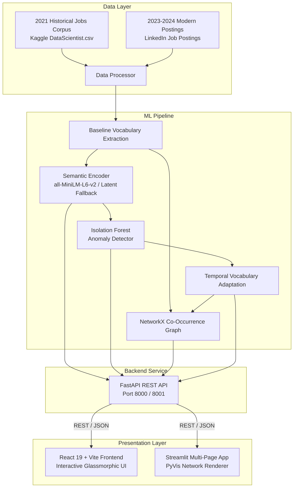

# ⚡ SkillShift: Adaptive Job-Matching & Concept Drift Detection Platform

[](https://fastapi.tiangolo.com)
[](https://react.dev)
[](https://www.python.org/)
[](https://scikit-learn.org)
[](https://networkx.org/)
[](LICENSE)

> **SkillShift** is an end-to-end Machine Learning intelligence platform designed to detect, quantify, and adapt to rapid **Concept Drift** and **Out-of-Distribution (OOD)** skill emergence in tech labor markets.

---

## 📌 Table of Contents

- [Overview & The "ATS Stale Penalty" Problem](#-overview--the-ats-stale-penalty-problem)
- [Key Features](#-key-features)
- [System Architecture](#-system-architecture)
- [Project Directory Structure](#-project-directory-structure)
- [Getting Started](#-getting-started)
  - [1. Prerequisites](#1-prerequisites)
  - [2. Backend Setup (FastAPI & ML Pipeline)](#2-backend-setup-fastapi--ml-pipeline)
  - [3. Frontend Setup (Modern React + Vite)](#3-frontend-setup-modern-react--vite)
  - [4. Alternative Streamlit Frontend](#4-alternative-streamlit-frontend)
  - [5. (Optional) Kaggle Dataset Ingestion](#5-optional-kaggle-dataset-ingestion)
- [REST API Reference](#-rest-api-reference)
- [Machine Learning & Concept Drift Methodology](#-machine-learning--concept-drift-methodology)
- [Publishing as a Private GitHub Repository](#-publishing-as-a-private-github-repository)
- [Security & Best Practices](#-security--best-practices)
- [License](#-license)

---

## 🌟 Overview & The "ATS Stale Penalty" Problem

The tech industry experienced an unprecedented paradigm shift between 2021 and 2024 with the explosion of **Generative AI, LLMs, RAG architectures, LangChain, Vector Databases, and Modern Web Frameworks (e.g., Next.js 14, Tailwind CSS)**.

Traditional Applicant Tracking Systems (ATS) and semantic job-matching engines trained on historical labor data (2019–2021):
1. **Penalize Modern Talent**: Flag modern GenAI and cutting-edge framework skills as anomalous, out-of-distribution (OOD) noise or irrelevant tokens.
2. **Experience Concept Drift**: Semantic representations degrade over time as vocabulary distributions diverge from training baselines.
3. **Distort Talent Pipelines**: Qualified candidates with modern technical competencies receive falsely deflated match scores.

### The SkillShift Solution
SkillShift monitors real-time market data, dynamically expands baseline skill graphs, identifies emergent vocabulary using **Isolation Forests & Sentence Embeddings**, and performs dual-model candidate evaluations comparing **Stale (2021 ATS)** vs. **Adapted (2024 Modern)** scoring.

```
┌───────────────────────────┐      ┌───────────────────────────┐
│     Stale ATS (2021)      │      │    Adapted Model (2024)   │
│ Score: 28%  [OOD Flagged] │  ──► │ Score: 94% [+66% Recovery]│
│ LangChain / RAG penalized │      │ Modern AI stack validated │
└───────────────────────────┘      └───────────────────────────┘
```

---

## ⚡ Key Features

- **📊 Executive Drift Dashboard**: Real-time KPI cards tracking vocabulary growth (+21.4%), cumulative vocabulary expansion curves, and monthly OOD skill inflow charts.
- **🎯 Dual-Model Resume Matcher Studio**: Side-by-side evaluation of candidates against job archetypes with automatic diagnostic breakdowns explaining exact penalty rationale and recovery delta.
- **🕸️ Interactive Skill Co-Occurrence Network**: Force-directed, physics-enabled graph visualization (`vis-network`) mapping semantic skill clusters and cross-domain bridges (e.g., Python ↔ LangChain ↔ LLMs).
- **📡 Multi-Dimensional Drift Radar**: Domain-specific emergence monitoring across Generative AI, Cloud/DevOps, Classical Data Science, and Modern Web.
- **🛡️ High-Fidelity Fallback & Offline Resilience**: Seamless zero-crash execution featuring lightweight hash-based semantic encoders and simulated market datasets when offline or running without heavy PyTorch dependencies.

---

## 🏗️ System Architecture



---

## 📁 Project Directory Structure

```text
AML/
├── backend/
│   ├── __init__.py
│   └── main.py                     # FastAPI server with CORS, matching, graph & drift endpoints
├── ml_pipeline/
│   ├── __init__.py
│   ├── data_processor.py           # Historical & modern dataset ingestion & preprocessing
│   └── drift_detector.py           # SkillDriftDetector, Isolation Forest OOD & NetworkX graph
├── frontend-react/                 # Modern React 19 + Vite Application
│   ├── public/                     # Static assets and icons
│   ├── src/
│   │   ├── components/
│   │   │   ├── Dashboard.jsx       # Executive analytics & charts
│   │   │   ├── DriftRadar.jsx      # Multi-dimensional radar analysis
│   │   │   ├── Matcher.jsx         # Dual-model side-by-side resume evaluator
│   │   │   └── NetworkGraph.jsx    # Interactive force-directed vis.js graph
│   │   ├── data/
│   │   │   └── mockData.js         # Fallback data for offline resilience
│   │   ├── services/
│   │   │   └── api.js              # Axios service with auto-port fallback (8000 -> 8001)
│   │   ├── App.jsx                 # Main layout, dark/light theme & routing
│   │   ├── index.css               # Design system, glassmorphism tokens & CSS variables
│   │   └── main.jsx                # React root bootstrap
│   ├── package.json
│   └── vite.config.js
├── frontend/
│   └── app.py                      # Alternative Python Streamlit multi-page interface
├── download_data.py                # Automated Kaggle dataset downloader
├── requirements.txt                # Python backend & ML dependencies
├── .env.example                    # Template environment variables
├── .gitignore                      # Git ignore rules for data, venv, and node_modules
└── README.md                       # Comprehensive platform documentation
```

---

## 🚀 Getting Started

### 1. Prerequisites

- **Python**: `3.10` or higher
- **Node.js**: `18.0.0` or higher & **npm**
- **Git**

---

### 2. Backend Setup (FastAPI & ML Pipeline)

1. **Open your terminal** and navigate to the project directory:
   ```bash
   cd AML
   ```

2. **Create and activate a virtual environment**:
   - **Windows (PowerShell)**:
     ```powershell
     python -m venv venv
     .\venv\Scripts\Activate.ps1
     ```
   - **macOS / Linux**:
     ```bash
     python3 -m venv venv
     source venv/bin/activate
     ```

3. **Install Python dependencies**:
   ```bash
   pip install -r requirements.txt
   ```

4. **Start the FastAPI server**:
   ```bash
   uvicorn backend.main:app --reload --port 8000
   ```
   *The API will be available at `http://localhost:8000` with interactive Swagger docs at `http://localhost:8000/docs`.*

---

### 3. Frontend Setup (Modern React + Vite)

1. **Open a new terminal window** and navigate to `frontend-react`:
   ```bash
   cd AML/frontend-react
   ```

2. **Install frontend dependencies**:
   ```bash
   npm install
   ```

3. **Launch the development server**:
   ```bash
   npm run dev
   ```
   *Open `http://localhost:5173` in your browser to access the SkillShift Dashboard.*

---

### 4. Alternative Streamlit Frontend

If you prefer a pure Python interface:

```bash
# Ensure your virtual environment is active
streamlit run frontend/app.py
```
*The Streamlit interface will open automatically at `http://localhost:8501`.*

---

### 5. (Optional) Kaggle Dataset Ingestion

To populate raw datasets from Kaggle instead of using baseline mock samples:

1. Obtain your `kaggle.json` API token from [Kaggle Account Settings](https://www.kaggle.com/settings).
2. Place `kaggle.json` into `~/.kaggle/kaggle.json` (or `%USERPROFILE%\.kaggle\kaggle.json` on Windows).
3. Run the download script:
   ```bash
   python download_data.py
   ```

---

## 📡 REST API Reference

### `POST /api/match`
Evaluates a candidate's resume against a target role profile using both stale and adapted semantic models.

**Request Body:**
```json
{
  "resume_text": "AI Engineer proficient in Python, LangChain, RAG architectures, Prompt Engineering, and Vector Databases.",
  "target_job_title": "Machine Learning Engineer"
}
```

**Response (`200 OK`):**
```json
{
  "score_before_adaptation": 0.28,
  "score_after_adaptation": 0.94,
  "missing_skills_flagged": [
    "langchain",
    "prompt engineering",
    "rag architectures",
    "vector databases"
  ],
  "explanation": "The stale model penalized modern AI skills as irrelevant noise or out-of-distribution. After adaptation, it recognized them as highly relevant to modern job requirements."
}
```

---

### `GET /api/drift-metrics`
Returns temporal vocabulary growth and monthly out-of-distribution skill detection counts.

**Response (`200 OK`):**
```json
{
  "timeline": [
    { "month": "2023-01", "vocab_size": 2450, "new_skills_detected": 14 },
    { "month": "2023-03", "vocab_size": 2518, "new_skills_detected": 46 },
    { "month": "2023-06", "vocab_size": 2621, "new_skills_detected": 31 },
    { "month": "2023-09", "vocab_size": 2728, "new_skills_detected": 42 },
    { "month": "2023-12", "vocab_size": 2806, "new_skills_detected": 18 },
    { "month": "2024-03", "vocab_size": 2894, "new_skills_detected": 35 },
    { "month": "2024-05", "vocab_size": 2975, "new_skills_detected": 33 }
  ]
}
```

---

### `GET /api/skill-graph`
Returns top node entities and weighted co-occurrence edges for force-directed network rendering.

---

## 🧪 Machine Learning & Concept Drift Methodology

| Component | Technical Implementation | Purpose |
| :--- | :--- | :--- |
| **Semantic Embedding** | `sentence-transformers/all-MiniLM-L6-v2` (384-dim dense vectors) | Captures high-order semantic representations of job requirements and candidate profiles. |
| **OOD Detection** | `sklearn.ensemble.IsolationForest` (5% contamination) | Flags new skills that statistically diverge from the historical baseline embedding space. |
| **Graph Network** | `networkx.Graph` with weighted co-occurrence edges | Models multi-hop skill adjacency and reveals emergence of new technological sub-clusters. |
| **Adaptation Mechanism** | Dynamic baseline vocabulary expansion & profile vector updating | Normalizes newly accepted skills into the target archetype embedding space to eliminate stale penalty. |

---

## 🔒 Publishing as a Private GitHub Repository

Follow these step-by-step instructions to initialize and push this project as a **private GitHub repository**:

### Option A: Using the GitHub CLI (`gh`) *(Recommended)*

1. **Authenticate with GitHub** (if not already authenticated):
   ```bash
   gh auth login
   ```

2. **Initialize Git and commit all files**:
   ```bash
   cd AML
   git init
   git add .
   git commit -m "feat: initial commit of SkillShift platform with concept drift engine"
   ```

3. **Create the private repository and push automatically**:
   ```bash
   gh repo create skillshift --private --source=. --remote=origin --push
   ```

---

### Option B: Using the GitHub Web Interface

1. **Create a new repository on GitHub**:
   - Go to [github.com/new](https://github.com/new).
   - Enter Repository name: `skillshift` (or your preferred name).
   - Select **Private**.
   - **Do NOT** check "Add a README file", ".gitignore", or "license" (we already have configured them).
   - Click **Create repository**.

2. **Push your local code to GitHub**:
   ```bash
   cd AML
   git init
   git add .
   git commit -m "feat: initial commit of SkillShift platform"
   git branch -M main
   git remote add origin https://github.com/<YOUR_GITHUB_USERNAME>/<YOUR_REPO_NAME>.git
   git push -u origin main
   ```

---

## 🛡️ Security & Best Practices

- **Never Commit Raw Datasets**: The `.gitignore` is pre-configured to exclude large CSVs and data folders (`data/`). GitHub enforces a strict 100MB per-file limit.
- **Never Commit API Keys**: Never commit `kaggle.json` or `.env` containing sensitive credentials.
- **Clean Node Modules & Virtual Environments**: `node_modules/` and `venv/` are excluded from version control to maintain a lightweight, fast repository clone.

---

## 📄 License

This project is licensed under the MIT License — see the [LICENSE](LICENSE) file for details.

---

<div align="center">
  <sub>Built with ❤️ for intelligent talent analytics and adaptive machine learning systems.</sub>
</div>
